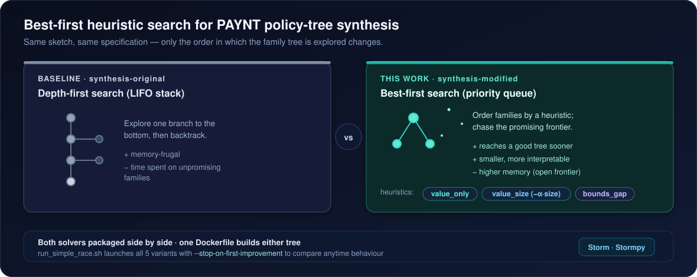

<div align="center">

<h1>DTPAYNT Heuristic Playground</h1>

<p><b>Best-first heuristic search for decision-tree policy synthesis in PAYNT</b></p>

<p>
  
  
  
  
  <a href="LICENSE"></a>
</p>

</div>

This repository keeps two [PAYNT](https://github.com/randriu/synthesis) source trees side by side so that a **best-first, heuristic-ordered** family search can be compared against the original depth-first solver — on identical sketches and specifications, with a one-command Dockerized setup. PAYNT synthesises probabilistic programs and finite-state controllers; here the focus is **decision-tree policies**, where the order in which the family tree is explored decides how quickly a small, good tree is found.

- **`synthesis-original/`** — upstream depth-first solver (LIFO stack), packaged with the CAV artefact.
- **`synthesis-modified/`** — priority-queue synthesizer with pluggable heuristics, `--stop-on-first-improvement`, and enhanced logging.

<p align="center">
  
</p>

## What's inside

```
.
├── Dockerfile            # multi-stage image; builds either source tree via SRC_FOLDER
├── run_simple_race.sh    # races all 5 variants in Docker (consensus-4-2, depth 4)
├── REPORT.md             # writeup of the "race to the first good-enough tree" experiment
├── synthesis-original/   # baseline PAYNT — depth-first stack search
└── synthesis-modified/   # heuristic PAYNT — priority-queue search (experiments-dts.py)
```

## Build the Docker images

From the repository root:

```bash
# modified priority-queue solver (default SRC_FOLDER)
docker build -t dtpaynt-modified .

# baseline stack solver (switch the build argument)
docker build --build-arg SRC_FOLDER=synthesis-original -t dtpaynt-original .
```

Each image ships Storm, pycarl, Boost and matplotlib, exposing `/opt/synthesis-{modified,original}` inside the container.

## Run the race

`run_simple_race.sh` builds the images if needed and launches all five variants in parallel, each with `--stop-on-first-improvement`, writing per-run logs and exports to `results/simple_race/` on the host:

```bash
bash run_simple_race.sh
# knobs (env): TIMEOUT=600  BENCHMARK_PATH=models/dts-q4/consensus-4-2  MAX_DEPTH=4
```

The five variants are: **original (DFS)**, and **modified (BFS)** with `value_only`, `value_size α=0.01`, `value_size α=0.1`, and `value_size α=0.5`. See [`REPORT.md`](REPORT.md) for the experiment design, the DFS-vs-BFS pseudocode, and discussion. *(The summary table in the report is an illustrative sketch of the expected outcome — run the race to produce real numbers for your machine.)*

## Heuristics

The modified synthesizer selects a priority heuristic via `--heuristic` (wired through `synthesis-modified/experiments-dts.py`):

| Flag | Priority rule |
|------|---------------|
| `value_only` | Greedy best-first on the latest improving value. |
| `value_size` + `--heuristic-alpha α` | Penalise wide families: `value − α·size` (start at α = 0.1). |
| `bounds_gap` | Emphasise families that shrink the residual gap: `lower / (upper − lower + ε)`. |
| `upper_bound` | Backwards-compatible alias for `bounds_gap`. |

## Acknowledgements & license

Built on **PAYNT** (Andriushchenko et al.) and the [Storm](https://github.com/moves-rwth/storm) model checker via [Stormpy](https://github.com/moves-rwth/stormpy). The bundled `synthesis-original/` and `synthesis-modified/` trees carry their upstream licenses; this repository is released under **CC-BY-4.0** (see [`LICENSE`](LICENSE)).
